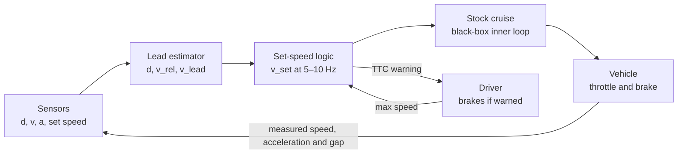

# Brief: Cruise-Control Set-Speed Controller — Signals, Simulation, Feasibility

2026-11-19

## Objective and concept

Decide, with data and simulation, whether car-following can be achieved by **only adjusting the set speed of the stock cruise control**, leaving throttle and braking to the vehicle's own controller.

The proposed system is an outer loop. It reads ego speed, longitudinal acceleration, cruise set speed and distance to the vehicle ahead, computes an optimal set speed, and updates the cruise setpoint. The stock cruise controller is the inner loop and is treated as a black-box plant to be identified from logs.

The central feasibility question: is the stock cruise controller fast enough, and does it have enough deceleration authority, to keep a safe gap in realistic traffic — and how often would the driver still have to brake?

The only command leaving the system is the cruise set speed; the driver keeps the maximum speed and receives a warning when cruise alone cannot keep a safe gap.

## Scope and non-goals

In scope:

- Read and characterize the available signals from recorded drive logs.
- Identify the dynamic behaviour of the stock cruise controller from those logs.
- Specify a set-speed algorithm, simulate it against identified dynamics and logged lead-vehicle traces, and report feasibility.

Out of scope for this phase:

- Any closed-loop control of a real vehicle. All work is offline: logs, analysis, simulation.
- Direct throttle or brake actuation.
- Stop-and-go below the cruise minimum speed.
- Emergency braking. The system can only warn; the driver remains responsible for braking.
- **Writing anything to the car.** Every phase here only reads. The command path (how a set speed would reach the cruise) is studied on paper and in the catalogue only (see "The command path" below); trying it on the car needs the owner's separate decision and its own safety plan.

## What is already known (2026-11-19)

The car is a BMW G20 with the MGU head unit (iDrive 7). Our apps run on the head unit as OAP apps (Node 8.16) and read vehicle signals over SOME/IP. All of the below comes from the Signal Probe app's logs (`apps/signal_probe`, sets S8 and S14; the field table is `apps/signal_probe/fields.js`, the report `docs/car/CP-REPORT.md` §13) and from the interface catalogue copied off the car (`reference/car/2026-11-15/someip/someip-interfaces.json`). "Seen" means read on the car; "declared" means it is in the catalogue and in the probe but no value has been read yet.

### The car

- **No radar and no adaptive cruise.** The lead-vehicle data comes from the front camera (KAFAS). The car has the front collision warning, so the camera does track the vehicle ahead. Camera-only range is the second big feasibility risk after braking authority: its noise and latency are unknown.
- **The stock cruise is BMW's Dynamic Cruise Control** (probe value `LDM_SYM_DCC`), with a speed limiter as the other mode (`LDM_SYM_SLD`). DCC is sold as cruise "with braking function"; how much it brakes on a setpoint drop has not been measured on this car. That is Phase 2's first number.
- **The driver's controls:** the set speed moves in 1 km/h steps (a tap) and to the next multiple of 10 (a press past the detent). To be confirmed in Phase 1 scenario 2.

### Signals: what each one is on this car

| Signal of this brief | Probe tag | Interface . member | State |
| --- | --- | --- | --- |
| Cruise set speed | `hud-data` → `cruise` | `DisplayDataServer.functionalLibraryData` | **Seen**: km/h as a plain number (61, 59, 40); 65535 = none |
| Cruise state | `hud-data` → `ldm`, `ldmColour` | same | **Seen**: `LDM_SYM_DCC` / `LDM_SYM_SLD` / `LDM_SYM_NONE`; `LDM_ACTIVE` / `LDM_OFF`. Suspended (driver brakes, then resumes) not yet told apart |
| Cruise state, second source | `ldm-guidance` | `FASuS.displayDriverAssistenceSystemLongitudinalGuidance` | **Seen**: `XCC_AKTIV` / `SLD_AKTIV` / none; its own set speed is encoded, not km/h |
| Distance to the vehicle ahead | `front-vehicle` → `gapX` | `GapVehicleAhead.DataFrontVehicle` (event) | **Seen**, raw: 57..1736 while driving, **4093 = no target** (parked). Unit and scale unknown |
| Relative or absolute speed of the lead | `front-vehicle` → `speedX` | same | **Seen**, raw: about 1500 when both cars hold the same speed, which suggests an offset encoding of relative speed. Unknown until calibrated |
| Lateral offset and lateral speed | `front-vehicle` → `gapY`, `speedY` | same | Declared (added in probe 0.2.0) |
| Target id and validity | `front-vehicle` → `object`, `qualifier`, `qualifierExt` | same | Declared. The id is how a cut-in or cut-out should show |
| Lead type, moving or standing, width | `front-vehicle-ext` | `GapVehicleAhead.DataFrontVehicleExtended` | Declared |
| A second gap value | `gap-ahead` | `GapVehicleAhead.GapVehicleDrivingAhead` | Declared |
| Up to six tracked objects (distance, speed, acceleration, lane) | `keep-dist-1`, `keep-dist-2`, `keep-dist-params` | `KeepDistanceObjectsLegacy` (events) | Declared. If it answers, it gives the lead's acceleration directly |
| Raw camera object lists | set S15 (21 events) | `ObjectsFrontCamera`, `FusedSensorDetection`, … | Declared; heavy, only for short reads |
| Ego speed | `speed` | `chassis.SpeedAcceleration.vehicleSpeed` | Declared. The displayed speed is `display-speed` |
| Longitudinal acceleration | `accel-long`, `accel-long-cog`, `accel-long-est`, `cds-accel-long`, `dynamics-long` | `SpeedAcceleration`, `AccelerationLongitudinalLateralProvision`, `CDS2` | Declared, three independent sources (sensor, estimated, mass-centre) |
| Road slope | `gradient` | `SurfaceInformationProvision.longitudinalGradientSurface` | Declared |
| Yaw rate (curves, target loss) | `yaw-speed`, `yaw-rate` | `SpeedAcceleration`, `YawRateProvision` | Declared |
| Collision warning request | `warn-brake` | `FASuS.requestWarnBrakeCoordinatorDisplay` | Declared. Shows when BMW's own warning fires: a ground truth for the TTC warning logic |
| Brake and accelerator pedal | — | — | **Not mapped yet.** To be found in the catalogue (chassis / powertrain interfaces) |

So of the required signals only the set speed, the cruise state and a raw gap have been seen; nothing has a verified unit except the set speed. The first drive with set S14 on is what turns "declared" into numbers.

### What the measuring tool can and cannot do today

- **Rate.** Signal Probe throttles on purpose: one line per field every 0.5–1 s, with a cap per field, and the head unit's log file rotates at 256 KB with one older file kept. A ten-minute drive with S14 on overruns it; so far the lead has read the log live over SSH. This is far from "10 Hz on a common time base".
- **Time base.** A line's time is when the head unit's app received the value, not when the sensor measured it. Some payloads carry their own timestamps or counters; the probe skips them today.
- **Native rate.** How often the car itself sends each signal is unknown. `TrafficSignRecognition` arrives about twice a second; the chassis signals are probably much faster. If the gap arrives at 2–5 Hz, that bounds everything downstream.

## Phase 0 — A recorder

Goal: a way to collect the Phase 1 logs at all.

- A recording mode (in Signal Probe or a small app of its own): every value of the chosen fields, unthrottled, appended to a file in the app's data folder with a monotonic receive time in milliseconds, the payload's own timestamp or counter where it has one, and a sequence number per field. One compact line per sample (CSV or JSON lines), files cut by size, old files removed by a quota, a start / stop control and a marker button for "scenario N starts".
- Budget it first: bytes per second at the car's native rates, the head unit's free space, and the CPU the app may use (an OAP app is killed and counted as crashed if it misbehaves; two crashes uninstall it).
- Read-only: fields with a getter or notifier and events only. No setter, no method.
- Privacy: no position, no road names, nothing but the fields in the table above.
- A converter on the Mac to one table per drive (pandas), resampled to a common clock, with the native rate and the jitter of every field reported.

**Exit criterion:** a 20-minute recording survives on the head unit and converts to a table with the measured native rate of every field.

## Phase 1 — Signal acquisition and characterization

Goal: a verified signal map and a quality report for every signal the algorithm needs.

### Required signals

| Signal | Unit | Need | What to determine |
| --- | --- | --- | --- |
| Ego vehicle speed | m/s | Required | Source (wheel vs. displayed), rate, resolution, latency, offset vs. GPS |
| Longitudinal acceleration | m/s² | Required | Sensor vs. derived, gravity/slope component, noise level, rate |
| Cruise set speed | km/h | Required | Resolution (1 or 5 km/h steps), unit, update behaviour |
| Cruise state | enum | Required | Active / standby / override / off; minimum and maximum active speed |
| Distance to object ahead | m | Required | Range, resolution, rate, latency, value when no target |
| Target valid / target ID | flag / id | Required if available | How target changes are signalled (cut-in, cut-out, loss) |
| Relative speed to target | m/s | Preferred | Whether radar provides it directly; sign convention |
| Brake and accelerator pedal | flag / % | Required | Detect driver overrides; exclude those segments from identification |
| Road slope | % or derived | Optional | Needed to separate grade effects from cruise behaviour |

For each signal record: bus/source, message name, scaling, sample rate, timestamp source, observed latency, noise (standard deviation at steady state), dropouts and invalid values.

Scaling by calibration, since the raw units are unknown: the set speed and the displayed speed are in km/h and anchor the ego speed; the gap is anchored by following a car at a steady speed with a known reference (lane markings of known length on video, or a phone rangefinder used by the passenger), the relative speed by the derivative of the calibrated gap.

Latency of the reading path, which adds to the cruise dead time: estimate it by cross-correlating two sources of the same quantity that travel different paths (the three acceleration sources; the derivative of ego speed against measured acceleration), and by a filmed event (the brake lamps of the lead in the video against the first change of the gap signal).

### Logging plan

Collect at least 10 Hz on all signals, with a common time base. Each scenario repeated 3 times at 2–3 speeds (e.g. 60, 90, 120 km/h):

1. Steady cruise, no target, flat road.
2. Set-speed steps up and down: ±1, ±5, ±10, ±20 km/h.
3. Steady following at several gaps.
4. Lead vehicle slows gently, then firmly.
5. Cut-in, cut-out and target loss on curves.
6. Uphill and downhill sections with cruise active.

The driver keeps full control; all scenarios are performed by normal driving and cruise operation only.

**Exit criterion:** every required signal mapped, timestamped consistently, with latency and noise numbers.

## Phase 2 — Cruise-control plant identification

Goal: a simple, validated model of how the stock cruise controller turns a set-speed change into acceleration. This model is the plant in every simulation.

Starting model: first-order lag with dead time, plus acceleration and deceleration limits.

$$
\tau_c \, \dot{v}(t) + v(t) = v_{set}(t - T_d), \qquad a_{min} \le \dot{v} \le a_{max}
$$

Fit it on the set-speed step logs (Phase 1, scenario 2): the driver makes the steps by hand with the steering-wheel buttons, so the whole identification is read-only. If the residual is large, try a second-order model or separate parameters for speed-up and slow-down.

| Parameter | How to measure | Why it matters |
| --- | --- | --- |
| Dead time T_d (s) | Time from setpoint change to first measurable acceleration change | Sets the minimum time gap and the update rate |
| Time constant τ_c (s) | Fit to step responses | Limits how fast gap errors can be corrected |
| Max acceleration a_max (m/s²) | Large upward steps | Catch-up behaviour; comfort |
| Max deceleration a_min (m/s²) | Large downward steps, flat road and downhill | **Key feasibility number**: does cruise brake, or only lift off? |
| Setpoint resolution | Smallest step the cruise accepts | Quantization noise in the loop |
| Setpoint update rate | Max changes per second accepted | Bounds the controller rate |
| Min / max active speed | Cruise state vs. speed | Operating envelope |
| Step-size nonlinearity | Compare ±1 vs ±20 km/h responses | Whether large steps are handled aggressively |

**Exit criterion:** model reproduces held-out step logs with speed RMS error below 0.5 km/h (proposed threshold).

## The command path (paper study only in this phase)

The loop needs a way to hand the set speed to the cruise. Nothing here is tried on the car in this phase; the task is to describe the options and their unknowns so the simulation uses honest numbers.

- **What the catalogue shows.** `de.bmw.dass.driverassistanceapplications.MultimodalControlDriverAssistance` has a field `multimodalControlDriverAssistance` with a **setter (id 1) and no getter**, whose members include an on / off request, a mode and a set-speed value. It looks like the head unit's own path for voice or gesture control of the assistance functions. Whether this car's cruise accepts it, in which states, how fast and how often, is unknown. `functionAvailabilityDriverAssistance` (read, in the probe as `assist-avail`) reports per function whether such a proposal is available: read it on the drive.
- **Unknowns that decide feasibility as much as a_min does:** acceptance at all on a car without adaptive cruise; the delay from the write to the cluster showing the new set speed; the maximum accepted rate; whether a write pops a confirmation or a message; whether a rejected write is silent.
- **The platform.** The head unit is an infotainment computer, not a real-time controller: a Node process with garbage-collection pauses, a message path through the gateway, no timing guarantee. Assume a jitter of some hundreds of milliseconds until measured, and put it in the simulation as its own delay and dropout term next to T_d.
- **In the simulation** carry the command path as parameters (delay, jitter, accepted rate, drop probability) and sweep them; report the worst values at which the concept still passes.

## Failure modes to design for

The outer loop can stop at any moment (the app is restarted, the head unit reboots, the camera loses the target). The stock cruise then simply keeps the last set speed.

| Failure | What the car does | What the design must guarantee |
| --- | --- | --- |
| The app stops while following a slower lead | Cruise holds the last (lowered) set speed | Safe by itself; the driver sees the set speed stays low |
| The app stops just after raising the set speed toward the driver's maximum | Cruise accelerates to it | The raise rate limit bounds the harm; the warning disappears silently — the cluster must show "following off" from a watchdog on the cluster side, not from the dead app |
| Target lost on a curve | No lead | Hold the set speed for a time before returning to the driver's maximum (S6); never accelerate into a curve on a lost target |
| The gap signal freezes at its last value | The loop sees a constant gap | A staleness check on every input (sequence number or receive time); stale input = no target and a warning |
| The camera is blind (sun, dirt, rain) | Invalid qualifier, or silence | The same; BMW's own collision warning is equally blind, so the driver is told |
| The driver brakes or overrides | Cruise suspends | The loop stops commanding and resumes only with the driver's resume |

BMW's own front collision warning stays untouched and independent in every case; this system adds a warning and never replaces one.

## Phase 3 — Lead-vehicle state estimation

Goal: a smooth, low-latency estimate of the gap d, relative speed v_rel and lead speed v_lead = v + v_rel.

- If radar relative speed exists, use it as the primary measurement and check it against the derivative of distance.
- If not, estimate it with an alpha-beta filter or a Kalman filter on state [d, v_rel], optionally adding a_lead.
- Reset or re-initialize the filter on target change (cut-in, cut-out, loss). Use a target-validity flag or a distance-jump threshold with hysteresis.
- Tune for the trade-off between noise and lag. Report the estimator's added delay, because it adds to the cruise dead time.

**Exit criterion:** v_rel noise below about 0.3 m/s at steady following, added delay below 0.3 s, and clean behaviour on every logged target change (proposed thresholds).

## Phase 4 — Set-speed algorithm

The set speed tracks the lead vehicle's speed plus a correction that closes the gap error over time τ, capped by the driver's chosen speed.

$$
d_{des} = d_0 + h \, v
$$

$$
v_{ref} = v_{lead} + \frac{d - d_{des}}{\tau} + a_{lead} \, T_{lag}
$$

$$
v_{set} = \mathrm{quantize}\big(\mathrm{ratelimit}(\min(v_{driver},\ \max(v_{ref},\ v_{cc,min})))\big)
$$

Rules:

- No valid target: v_set = v_driver.
- The a_lead · T_lag feed-forward term is optional; enable it only if a_lead is clean enough after filtering. T_lag = identified dead time plus estimator delay.
- Rate limits: faster going down than up (down 12 km/h/s, up 1 km/h/s, to be tuned). *Decided 2026-11-19 (the owner, after the simulator's first batches):* the down limit is what lets the loop ask the cruise to slow; 3 km/h/s capped it at 0.83 m/s², so no plant could handle a lead braking at 1.5 m/s². 12 km/h/s is about 3.3 m/s².
- Quantize to the cruise step with ±1 step hysteresis to avoid setpoint chatter.
- Loop rate 5–10 Hz, bounded by the cruise setpoint update rate.

Driver-warning logic, evaluated every cycle:

$$
d_{needed} = d_0 + \frac{(v - v_{lead})^2}{2 \, |a_{min}|} \qquad \text{warn if } d < d_{needed} \ \text{or}\ TTC < TTC_{warn}
$$

Here a_min is the cruise deceleration identified in Phase 2, not a theoretical braking value. TTC_warn starts at about 3 s.

### Parameters to tune

| Parameter | Start value | Range to sweep |
| --- | --- | --- |
| d0, standstill gap | 5 m | 3–8 m |
| h, time gap | 2.0 s | 1.5–3.0 s |
| τ, gap-closing time | 4 s | 2–8 s; must exceed cruise τ_c + T_d |
| Rate limit down / up | 12 / 1 km/h/s | 1–15 / 0.5–2 (down widened 2026-11-19) |
| TTC_warn | 3 s | 2–4 s |

## Phase 5 — Simulation

Goal: run the Phase 4 algorithm against the Phase 2 plant model and realistic lead-vehicle behaviour, with realistic sensor imperfections.

The build brief for the simulator is `docs/AGENT-BRIEF-cruise-sim.md`: an interactive tool (an animated scene, time charts, every parameter as a setting, batch sweeps and a report) with the full scenario catalogue, twelve families that extend the table below. It can be built before any drive, on assumed plants, to show which measured numbers the verdict turns on; the identified plant and the logged traces are loaded into it later as files.

Simulation setup:

- Time step 10 ms for vehicle dynamics; controller runs at its real rate (5–10 Hz).
- Plant: the identified cruise model with its dead time, lag, acceleration limits and setpoint quantization.
- Sensors: inject the measured noise, latency and dropouts from Phase 1.
- Estimator: the actual Phase 3 filter, not ideal values.
- Two modes: synthetic scenarios, and replay of logged lead-vehicle traces (lead speed reconstructed as v + v_rel).

### Scenarios

| # | Scenario | Variations |
| --- | --- | --- |
| S1 | Approach slower lead from far | Speed difference 10, 30, 50 km/h |
| S2 | Steady following, lead speed oscillates | Amplitude ±5 km/h, period 10–30 s |
| S3 | Lead brakes and holds lower speed | −1, −2, −3, −4 m/s² |
| S4 | Cut-in at short gap | Gap 15–40 m, cut-in speed slower than ego |
| S5 | Cut-out revealing a slower vehicle | Hidden vehicle 20–60 km/h slower |
| S6 | Target loss on a curve, then reacquired | Loss 1–5 s |
| S7 | Downhill following | Grade 3–6%, if grade data exists |
| S8 | Replay of real logged traffic | All logged following segments |

Run a parameter sweep over the Phase 4 tuning table and a sensitivity sweep over the plant parameters (±30% on T_d, τ_c, a_min) to check robustness.

## Evaluation metrics and feasibility criteria

The concept is feasible if it keeps a safe gap in normal traffic using cruise authority alone, and needs the driver only in clearly abnormal events. All thresholds below are proposals to confirm before the simulation runs.

| Metric | Proposed pass threshold |
| --- | --- |
| Minimum time gap in S1, S2, S8 | ≥ 1.0 s |
| Minimum TTC in S1, S2, S8 | ≥ 4 s |
| Gap error RMS during steady following | ≤ 0.3 · h · v |
| Lead braking level handled without driver warning (S3) | ≥ 1.5 m/s² |
| Driver warnings per hour in replayed real traffic (S8) | ≤ 1 |
| Setpoint changes per minute | ≤ 20 (and within cruise update limit); kept by the owner 2026-11-19 although the simulator's first batches give 32–70 |
| Speed oscillation in S2 | No growth over time (amplitude ratio ≤ 1) |
| Robustness | All above hold with ±30% plant parameter error |

Decision:

- **Go:** all thresholds met. Next step would be a separate, safety-reviewed plan for any on-vehicle testing.
- **Conditional go:** fails only at high lead decelerations; usable as an advisory or comfort feature with driver warnings.
- **No-go:** fails in normal traffic (S1, S2, S8), or warnings are frequent. Most likely cause: insufficient cruise deceleration (a_min) or too much dead time.

The main known risk is braking authority. If the stock cruise only lifts off, a_min may be around −0.5 to −1 m/s² on flat road, which may not be enough for ordinary traffic. Phase 2 must answer this first; if a_min is too small, stop before building the full simulation.

## Deliverables and open questions

### Deliverables

- [ ] Recorder and converter, with the measured native rates (Phase 0)
- [ ] Signal map and signal quality report (Phase 1)
- [ ] Identified cruise model with parameters and fit plots (Phase 2)
- [ ] Lead-vehicle estimator, tuned and validated on logs (Phase 3)
- [ ] Set-speed algorithm implementation, runnable offline (Phase 4)
- [ ] Simulation harness, scenario library and parameter sweep results (Phase 5)
- [ ] Command-path study and failure-mode table, with the parameters the simulation swept
- [ ] Feasibility report: metrics vs. thresholds, recommended parameters, go / conditional / no-go

Code in Python (numpy, scipy, pandas, matplotlib) unless decided otherwise; logs and results versioned together so every plot is reproducible.

### Open questions

- ~~Does the radar provide relative speed and a target ID, or only distance?~~ There is no radar. The camera's `DataFrontVehicle` carries a gap, a speed, an object id and qualifiers; their units and the meaning of the speed are open until the first calibrated drive.
- What is the cruise setpoint resolution and how quickly can it be changed? By hand: 1 km/h steps and jumps to the next ten (to confirm). By the command path: unknown, not tested in this phase.
- Does the stock cruise apply the brakes when the setpoint drops, or only lift off? Open; Phase 2's first measurement. Do the large downward steps on a flat road and downhill.
- Is road grade available, or must it be estimated from acceleration vs. speed derivative? A gradient event is declared (`gradient`); whether this car sends it is open.
- Where are the brake and accelerator pedal signals? Not mapped yet.
- What is the native rate of each signal on the head unit, and the latency of the reading path?
- Does the command path exist for this car at all (see "The command path")?
- Which pass thresholds in the evaluation table should be tightened or relaxed?
